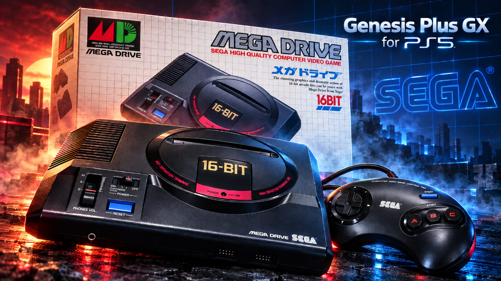

# Genesis Plus GX PS5

> **The title ID is now PPSA99921** (it was PPSA99011 up to 1.6, which PS5 FSR4 Showcase uses too). From 1.7 on the app installs in `/data/homebrew/PPSA99921/`; our old version under `/data/homebrew/PPSA99011/` stays as a separate icon until you delete it (check that the folder is ours first), and your games, saves and settings are kept. Replace the old ELF in your autoload. See [New title ID](#new-title-id-ppsa99921).

[Genesis Plus GX](https://github.com/ekeeke/Genesis-Plus-GX) 1.7.4, the accurate Sega 8/16-bit emulator, running on
a jailbroken PS5 as a **native home-screen app** with its own icon and background. One app plays:

| System | Files | BIOS needed (in `/data/genplus/bios/`) |
|---|---|---|
| Mega Drive / Genesis (SVP games such as Virtua Racing included) | `.md` `.gen` `.smd` `.bin` `.mdx` | none |
| Sega CD / Mega-CD | `.cue` (+ its tracks), `.chd`, `.iso` | `bios_CD_U.bin` (USA), `bios_CD_E.bin` (Europe) or `bios_CD_J.bin` (Japan) -- one is enough |
| Master System / Mark III | `.sms` | none |
| Game Gear | `.gg` | none |
| SG-1000 | `.sg` | none |

Cartridge games can also be inside a `.zip` or (since 2.2) a `.7z`; see [Games in a .zip or .7z](#games-in-a-zip-or-7z).
A Sega CD game started without a BIOS says which files are needed, and where they go, on the screen. The `.bin` tracks named in a `.cue` are not listed as games of their own.

**Inside the emulator, to access the main menu press L3 + R3.**

The PS5 layer follows the layout of PS5SX2 (the PCSX2 port) and of Snes9x PS5 and Mesen2 PS5, the ports it comes
from:

- `ps5/coreorbis` holds `main-boot.cpp`, the `orbis-shims/` and `include-orbis/`;
- `ps5/frontend` holds the user interface, the 3D game shelf and the glue to the Genesis Plus GX core;
- `ps5/proto/native` builds and signs `eboot.bin`;
- `ps5/installer` is the installer and helper payload.

Everything outside `ps5/` is the original Genesis Plus GX source, unchanged, apart from this README (the original
one is [README-Genesis-Plus-GX.md](README-Genesis-Plus-GX.md)) and two fixes in `libretro/libretro.c`'s cheats (see
[Cheats](#cheats)). The core (`core/`, with its CD
hardware, libchdr, Tremor and the Nuked/MAME sound chips) and its libretro port (`libretro/libretro.c`) are
compiled as they are: all 100 of their C files build for the PS5 without a single change (two fixes to the
libretro port's cheats aside). The frontend drives the
core through its libretro interface -- the most complete of its ports -- and plays the part RetroArch plays on a
PC; the GameCube/Wii user interface (`gx/`) and the other ports are not used.

> **Status (2.2):** builds with the ps5-payload-dev SDK into a signed native app, in two builds: **GPU** (RADV,
> Mesa's Vulkan driver for AMD GPUs, ported to the PS5 by [PS5_Vulkan](https://github.com/mihawk-99/PS5_Vulkan),
> linked into the app) and **CPU-only**. It passes 682 host tests, which run the same code (the core, the
> frontend, the GPU renderer, every built-in slang shader, the shelf on the GPU) on Linux with the PS5 calls
> simulated and the GPU renderer on a software Vulkan driver (lavapipe). **1.9 has run on a PS5** (a user's
> console, 4K at 59.94 Hz): the GPU renderer started, the 26 built-in shaders loaded, crt-easymode took 0.6 ms of
> the GPU a frame and the Mega Bezel Standard 2-3 ms, and a Sega CD game from a `.chd` (Earnest Evans) played at
> 60 fps with its CD music and no sound/picture drift. **What 2.0 and 2.1 add has only run in the host tests so far**:
> the shader cache, the shader parameters, your own `.slangp` presets and the shelf drawn by the GPU, and **all of
> 2.1** (network shares, shelf tabs, borders, the new covers, cheats). 2.1 has started on a PS5 Pro (11.60), where its
> GPU build could not reach a share (fixed in 2.1.1). 2.2's `.7z` support has only run in the host tests. If the GPU
> fails to start, the app draws with the CPU (see [The GPU renderer](#the-gpu-renderer)). If something fails, turn
> on Settings, SYSTEM, Debug logs, and send the logs in `/data/genplus/logs/`.

## How it works

The PS5 gives the controller only to the app in front, so Genesis Plus GX runs as a native app opened from its
icon, and the payload you send is its installer:

| Piece | What it is | In PS5SX2 |
|---|---|---|
| `eboot.bin` in `/data/homebrew/PPSA99921/` | **Genesis Plus GX itself**, a native app opened from its icon | PCSX2 (PPSA99203) |
| `sce_module/libc.prx` | the C runtime module every native app carries | the same file, byte for byte |
| `GenesisPlusGXPS5.elf` (payload) | the **installer**: installs or updates the app, then stays running as the **helper** | PS5SX2Installer.elf + PS5SX2Helper.elf |

When it opens, the app asks the helper to let it out of its sandbox; without that an app sees neither `/data`
nor USB drives. The request is the one PS5SX2 makes:

- **Who is asked, in order:** the Genesis Plus GX helper (127.0.0.1:9088 since 1.7; 1.6's used 9084; older helpers used 9077 up to 1.4 and
  9081 in 1.5, and are left alone), then etaHEN (9028) and the daemon on port 9069.
- **If nobody answers:** the app carries a copy of the helper (`GenesisPlusGXPS5-helper.elf`), sends it to the ELF
  loader (127.0.0.1:9021) and asks again. So the icon keeps working after a reboot, as long as the ELF loader
  runs.
- **What the helper allows:** only title PPSA99921. It gives the process the system's root folder and uid 0, as
  elfldr does for payloads. No other app is touched.

Genesis Plus GX PS5 only uses `/data/genplus/`, `/data/homebrew/PPSA99921/` and its own
`/user/appmeta/PPSA99921/`. It sits next to Snes9x PS5 (PPSA99922, helper port 9090), Mesen2 PS5 (PPSA99923, port 9091), FBNeo PS5 (PPSA99924, port 9092) and PS5SX2 (PPSA99203) without touching them.

## Versions

Every release carries its version in the file name: `GenesisPlusGXPS5-v2.2.elf` and `genplus-ps5-v2.2-src.zip`
(`make dist`). One ELF does both: the GPU draws the picture, or the CPU with Settings, SYSTEM, Renderer (from 2.1.1
on, releases no longer carry a separate CPU-only ELF; `make ps5` without PS5_VULKAN still builds one). When updating, replace the old ELF with the new one in your autoload or Payload Manager. In this
README, "`GenesisPlusGXPS5.elf`" always means the current release's ELF.

**2.2:** **games inside `.7z` archives** ([issue #3](https://github.com/MisterTemaki/genplusgxPS5/issues/3);
thanks to CroCop86 for the request). Mega Drive, Master System, Game Gear and SG-1000 games can now sit in a `.7z` as
they can in a `.zip`: on the shelf with their name, cover, border and cheats (named by the CRC the archive stores,
nothing unpacked), started from the console's drive, a USB drive or a network share. Sega CD discs inside a `.7z` are
not supported (see [Games in a .zip or .7z](#games-in-a-zip-or-7z)). A damaged, encrypted or too large archive says
why on the screen. The decoder is the LZMA SDK's (7-Zip 26.05, public domain). Tested on the PC only so far: 682 host
tests, 48 of them new (a 7z named, covered, bordered, with cheats and played like its zip twin; a disc, broken,
encrypted, unsupported and too large archives; a 7z on a share), and the reader's own 64 checks (LZMA, LZMA2, PPMd,
BCJ, ARM, Delta, solid, empty, cut short, changed bytes). Not yet on a PS5.

**2.1.1:** **a fix for network shares in the GPU build** (not yet confirmed on a PS5). In 2.1's GPU build (`GenesisPlusGXPS5-v2.1.elf`) every
share failed with "No server named ... was found. Use its IP address.", even with an IP address: PS5_Vulkan's platform
layer, linked in for the GPU driver, points some libc names at its own versions (its getaddrinfo always fails), and the
linker let that replace the app's own address lookup and folder listing for shares. Now the app's own versions are the
ones used; the build stops if that ever changes. The CPU-only build was not affected. Thanks to CroCop86 for the report
and the comparison with SwanStationPS5.

**2.1:** the features Snes9x PS5 2.7 got ([issue #3](https://github.com/MisterTemaki/genplusgxPS5/issues/3)),
after the design of [thatboialex](https://github.com/thatboialex)'s pull request to Snes9x PS5
([#3](https://github.com/MisterTemaki/snes9xPS5/pull/3)), and cheats.
- **Games on network shares (SMB and NFS):** keep your ROMs and Sega CD discs on a NAS or PC and play them from the
  shelf (Settings, LIBRARY, Network shares, with an on-screen keyboard and Test connection). Cartridges are read
  whole; discs stream from the share while you play. Saves, states, cheats, BIOS files and covers stay on the
  console. See [Network shares](#network-shares-smb-and-nfs).
- **Shelf tabs:** Internal, USB and Network; L1 / R1 switch tabs, Up / Down the system, L2 / R2 skip 10 games.
- **Borders around the picture:** each game's border from [The Bezel Project](https://github.com/thebezelproject)
  (Mega Drive, Sega CD, Master System, Game Gear, SG-1000; downloaded on the console with Border on Auto, or all at
  once with Settings, Download all borders), or a built-in frame. With the CPU and the GPU renderer, under every
  shader (the Mega Bezel presets draw their own). See [Borders around the picture](#borders-around-the-picture).
- **More covers:** fan translations, hacks and renamed ROMs find their game's cover (a table of 9,691 extra dumps,
  the ROM header's title); an online database ([Hasheous](https://hasheous.org)) fills in 1,638 games
  libretro-thumbnails lacks.
- **Cheats:** libretro-database `.cht` files (Game Genie and Pro Action Replay codes, for every system), the Cheat
  manager in the pause menu, and they reload by themselves when the `.cht` file changes. See [Cheats](#cheats).
- The new screens in the five languages. libsmb2 and libnfs (LGPL-2.1-or-later) are built in, at the upstream code
  with the security fixes Snes9x PS5 2.7 took (among them CVE-2025-57632 and CVE-2026-110712).
- **Tests:** 634 host tests, the new ones for all of the above (a share on this machine standing in for the NAS,
  with slow links, read errors and a share that goes away; the keyboard; the tabs; borders on the CPU and on the
  GPU under the shaders; downloads; the cover matching; every kind of cheat code on each system, the cheat manager
  and the reload), plus netfs's own 229 checks and the SMB tests against a real Samba server (58 of 60 pass here;
  the two that list a server's shares need a part of Samba this machine lacks, as for Snes9x PS5).

**2.0:** the GPU does more, and the pauses and spikes 1.9 showed on a PS5 are dealt with (checked in the host
tests; not yet on a console).
- **Picking a shader no longer freezes the game:** a shader is now built on a thread of its own -- the game goes on with
  the plain picture and "Preparing the shader..." on the screen meanwhile -- and the built shader is kept in
  `/data/genplus/cache/gpu-pipelines.bin`, so the next time it loads at once (on 1.9's PS5: about 1 s for
  crt-royale, 6 s for the Mega Bezel Standard, the picture frozen).
- **Shader parameters** (Settings, VIDEO, the GPU build): each of the shader's own settings (a CRT's mask,
  scanlines, curvature, glow...), changed with Left/Right while you see the game behind; Cross puts one back to the
  shader's value. Kept in `/data/genplus/shader-params.ini`. See [Shader parameters](#shader-parameters).
- **Your own shader presets:** RetroArch `.slangp` (or `.slang`) files put under `/data/genplus/shaders/` are listed
  after the built-in shaders, and compiled on the console the first time they are picked. See
  [Your own presets](#your-own-presets).
- **The shelf drawn by the GPU:** the backdrop, the covers in perspective, their reflections and the glow are drawn
  by the GPU at the TV's resolution (4K on a 4K TV), with mip-mapped covers; the text stays as it was.
- **CD music off the emulation thread:** a `.chd` is now decompressed ahead, on a thread of its own (1.9's PS5 log: the core's
  frame time jumped from 1.5 ms to 10-12 ms each time CD music crossed a block of the file). In the host tests, 139
  of 144 blocks were ready before the game asked for them.
- **The underrun count** in `boot.log` no longer counts the time on the shelf and in the menus, when no game
  sound is fed.
- **Saves:** when the new state can't take its name and even the old one can't be put back, the old one is still
  whole as `.prev`; the log and the screen now say so ("load it from the pause menu"), and the tests check every
  step of it with a storage made to fail.
- **Debug logs and the performance log are off by default** (Settings, SYSTEM). Turn the debug logs on to report a
  problem; a settings file of 1.9 keeps the value it had.
- **Tests:** 420, the new ones for all of the above (storage faults while a state is replaced, the underrun
  count, the CHD read-ahead, the shader cache, the parameters, your own presets, a broken preset, the GPU shelf
  against the CPU's).

**1.9:** the GPU, the saves made safer, five languages.
- **The GPU draws the picture** (the GPU build): RetroArch's slang shaders run as they are, single- and
  multi-pass, at the TV's resolution -- **4K** (3840x2160) on a 4K TV. Built in: the 11 shaders of 1.8 in their
  original GPU versions, **crt-guest-advanced** (with -fast and -ntsc), **crt-royale**, **ScaleFX**, the **Mega
  Bezel** (Potato and Standard), crt-geom, crt-easymode-halation, crt-hyllian, crt-aperture, crt-pi,
  crt-consumer, crt-yah, zfast-crt. Settings, SYSTEM, **Renderer** switches between GPU and CPU (after a
  restart). See [The GPU renderer](#the-gpu-renderer).
- **Saves:** a save is never written over while its backup couldn't be made (the new one goes beside it,
  `.srm.new` / `.brm.new`), and the core's own unprotected Sega CD write at the end of a game is off; a state
  replaces the old one only once the old one is safely `.prev`; every file written is read back before it takes
  its name; **save states carry a CRC-32** and one changed anywhere inside is refused (states of 1.8 still load).
- **Languages:** Settings, SYSTEM, **Language**: English (the default), Español, Português (Brasil), Français,
  Deutsch.
- **Performance log** (Settings, SYSTEM): `logs/perf-<system>-<game>.csv`, a row a second -- to check FMV, CD
  audio sync and long sessions on the console. See [Performance log](#performance-log).
- **Tests:** the save protections (a backup that can't be made, a `.prev` that can't be kept, a state changed by
  one byte, 200 save/load cycles), every menu text in each language, the GPU renderer and each of its shaders, the
  performance log.

**1.8:** the improvements asked for by a technical audit of 1.7.
- **Saves kept safe:** a state saved over another one keeps it as `.state1.prev`... and the pause menu can load it
  back (**Load the previous state**); a state of the wrong size (cut short, or from another core version) is
  refused instead of loaded, and the game goes on; before a session's first write, the battery save and the Sega CD
  backup RAM / RAM cart are copied to `.srm.bak` / `.brm.bak` (see [Saves kept safe](#saves-kept-safe)).
- **Settings for one game:** pause menu, **Settings for this game: Its own**. The picture, sound, emulation and
  control settings changed from then on apply to that game only (`/data/genplus/games/<system>/<game>.ini`); the
  others keep the global ones.
- **CD add-on** setting (Settings, EMULATION): Auto, MegaSD (MD+), Sega CD (MSU-MD) or None. An MD+ game whose
  tracks are in a `.chd` needs **MegaSD**: with Auto the core takes a `.chd` for an MSU-MD disc.
- **Sound:** the resampler (44.1 to 48 kHz) is now a 4-point Hermite instead of a linear one (cleaner high notes,
  CD music included); `boot.log` shows the queued sound's range and the rate control's range every minute.
- **Shaders:** if the shader takes most of the frame while the game runs slow, a message says to pick a lighter
  one (once a game). `make shader-bench` measures them; see [How heavy each shader is](#how-heavy-each-shader-is).
- **Tests:** CD music through MD+ from `.cue`/`.bin`, `.wav` and `.chd`, checked by ear in software (the pitch, both
  channels, the noise); Sega CD discs (`.cue`, `.chd`, US and European) booting a stand-in BIOS; the RAM cart's
  save and its `.bak`; states (`.prev`, a damaged one, 10 save/load cycles); per-game settings.

**1.7:** **New title ID: PPSA99921** (it was PPSA99011, which another app in the homebrew catalog uses; see
[New title ID](#new-title-id-ppsa99921)). Nothing under the old ID is touched (it may be
another app's): an earlier version of ours stays as its own icon until you delete it. Games, saves and settings are shared. The helper listens on port 9088.
**Updates from the app** (Settings, SYSTEM, Updates), as Porpoise does: see [Updates](#updates). The pic0/pic1
backgrounds are built into the ELF once (they are the same picture), so it is 22 MB instead of 30 MB. A big library
no longer holds "Looking for games..." for long: a zipped ROM's CRC comes from the zip's directory (nothing is
unpacked), each zip's system is remembered between starts, and the screen counts the games found, then shows a bar
while they are identified (1500 zips: 5.4 s on the PC the first time before, 0.5 s now).

**1.6:** **The helper downloads the covers with its own HTTPS.** In 1.5 the helper got nothing: the console's own HTTPS
(libSceSsl) fails outside the app's sandbox, and every cover failed in a few milliseconds while the counter went
down. The helper now has its own HTTPS: Mbed TLS, with Mozilla's list of certificate authorities, the server's
certificate checked as a browser does. It also keeps one connection for all its downloads. After updating, send
`GenesisPlusGXPS5-v1.6.elf` once (or let the app start its helper itself): 1.5's helper keeps running until the
console restarts, but 1.6 uses its own (port 9084).

**1.5:** **Covers download in the background.** 1.4 downloaded them before the app opened (up to 30 s with the
launch screen up) and restarted itself for new ones. Now the helper downloads them while you use the app: it starts
at once, the covers around the selection come first, and each one appears on the shelf as it lands ("Downloading
covers in the background... N left"). After updating, send `GenesisPlusGXPS5-v1.5.elf` once (or let the app start
its helper itself): 1.4's helper keeps running until the console restarts, but 1.5 uses its own (port 9081).

**1.4:** Square (fetch a cover again) works again on the console, and keeps the cover until the new one has
arrived; a ROM named as its official name gets its cover fetched again. **1.3:** CRT shaders (CRT Easymode style by default; see [CRT shaders](#crt-shaders)); MD+ and MSU-MD documented
([MD+ and MSU-MD](#md-and-msu-md-cd-music-in-mega-drive-games)); saves and states in one folder per system; the Sega CD
backup RAM written while the game runs; crash-safe writes; a stricter helper; and the fixes of a full code audit
(720p picture, Resume, odd files in the library, covers, downloads); a setting to turn the debug logs off.
**1.0:** the first release.

## New title ID (PPSA99921)

Up to 1.6, Genesis Plus GX PS5 used the title ID PPSA99011. The homebrew catalog
([homebrew.page](https://homebrew.page/app/PPSA99011/)) lists that ID for another app, and two apps with one title ID
can't be on the console together: the second one's folder and home-screen icon take the first one's place. So
from 1.7 on the app is **PPSA99921**, an ID no listed app uses, and it installs in `/data/homebrew/PPSA99921/`.

**Nothing under the old ID is touched:** `/data/homebrew/PPSA99011/` may just as well be the other app's, so the
installer never renames, removes or unregisters it. When our own earlier version is still there (its
`param.json` carries Genesis Plus GX PS5's content ID), the notification says so: it is a separate icon, the old version. To
remove it, delete the folder `/data/homebrew/PPSA99011/` (over FTP, for example), then select the old icon on the home
screen, press **OPTIONS** and choose **Delete** (deleting only the icon isn't enough: ShadowMountPlus finds the folder
again and puts the icon back).

Games, saves, states, covers and settings live in `/data/genplus/`, which doesn't depend on the title ID: the new
version finds everything where it was. The helper listens on a new port, because the helpers of 1.6 and older
only let PPSA99011 out.

**Replace the old ELF in your autoload** with the new ELF, or the old version keeps
being installed beside the new one.

## Updates

From 1.7 on, the app updates itself from this repository's GitHub releases, as
[Porpoise](https://github.com/elripalda/Porpoise-Dolphin-Emulator-for-PS5) does:

- **Settings, SYSTEM, Updates** shows the version you have and what to do: *Check now*, *Install 1.8 (27 MB)*,
  the download and install progress, then *Installed: restart* (Cross opens the new version).
- Once a day, when the app starts, it checks by itself; when a newer version is out, a notification says so.
  Nothing is installed without you choosing *Install*.
- The helper does the work (the app's own HTTPS doesn't work once it is out of its sandbox), with its own HTTPS
  (Mbed TLS, certificates checked). It asks `api.github.com/repos/MisterTemaki/genplusgxPS5/releases/latest` for
  the newest release and takes its asset `GenesisPlusGXPS5-v<version>-PPSA99921.zip`.
- The zip is checked before anything is written: its size and SHA-256 against what GitHub gives, then every file
  against the zip's own list (`PPSA99921/manifest.sha256`). Each file is written beside the old one, then all are
  put in place with `eboot.bin` last; files the new version no longer has are removed, and the home screen's
  copy of the art is refreshed. If anything fails before that, nothing has changed.
- Only `/data/homebrew/PPSA99921/` changes. Games, saves and settings (`/data/genplus/`) aren't touched.
- **Your autoload:** the app updated this way is newer than the ELF in your autoload. The older ELF sees that and
  leaves the app alone (its notification says so), and its helper still serves the newer app. Put the new ELF in
  your autoload when you can: a new version may come with a new helper.

For a release, `make dist` builds the zip (`build/dist/GenesisPlusGXPS5-v<version>-PPSA99921.zip`, the app
folder stored without compression, with its manifest). Attach it to the GitHub release, tagged `v<version>`,
next to the ELF. The same zip is what the homebrew catalog lists.

## Language

Settings (Triangle on the shelf), **SYSTEM**, **Language**: **English** (the default), **Español**, **Português
(Brasil)**, **Français**, **Deutsch**. The change applies at once, to every menu, message and notification, and is
kept in `genplus-ps5.ini` (`language=0` to `4`). The logs stay in English. Game names, the PS5's and the Mega
Drive's button names, and the shaders' names are not translated.

## Requirements

- A jailbroken PS5 with **kstuff** (or kstuff-lite) and an **ELF loader** on port 9021: elfldr, etaHEN, or the
  one PS5 Payload Manager uses.
- **ShadowMountPlus**, so the icon appears on the home screen (the same one PS5SX2 uses).
- Your own games, and a Sega CD BIOS for Sega CD games. None are included.

## Install and play

1. **Send `GenesisPlusGXPS5.elf`** with PS5 Payload Manager, or from a PC on the same network:
   ```sh
   nc -q0 PS5_IP 9021 < GenesisPlusGXPS5-v2.1.1.elf
   ```
   It installs the app in `/data/homebrew/PPSA99921/` (`eboot.bin`, `sce_module/libc.prx`, `param.json`, the
   icon and the backgrounds), shows **"Genesis Plus GX PS5 2.0 installed. Open it from the Genesis Plus GX PS5
   icon on the home screen."** and stays running as the helper.
2. **Open the Genesis Plus GX PS5 icon.** The game shelf appears and the controller works.
3. **Copy your games** to their system's folder, over FTP for example. The app makes the folders on its first
   start:

   | System | Games in | Your covers in |
   |---|---|---|
   | Mega Drive / Genesis | `/data/genplus/roms/MegaDrive` | `/data/genplus/covers/MegaDrive` |
   | Sega CD | `/data/genplus/roms/SegaCD` | `/data/genplus/covers/SegaCD` |
   | Master System | `/data/genplus/roms/MasterSystem` | `/data/genplus/covers/MasterSystem` |
   | Game Gear | `/data/genplus/roms/GameGear` | `/data/genplus/covers/GameGear` |
   | SG-1000 | `/data/genplus/roms/SG1000` | `/data/genplus/covers/SG1000` |

   On a USB drive the same layout goes under `genplus/roms` (`genplus/roms/MegaDrive`...). Subfolders inside
   them are fine (`roms/MegaDrive/RPG/`). The game's system comes from its extension, so a game left directly in
   `roms/` or in another folder is still found. A Sega CD `.cue` must sit next to its `.bin` tracks. The Sega CD
   BIOS goes to `/data/genplus/bios/`.

Tip: put `GenesisPlusGXPS5.elf` in your autoload, as PS5SX2 recommends for its payloads.

**Updating:** send the new `GenesisPlusGXPS5.elf` once. It compares every app file with the copy it carries and
rewrites only what changed; each file is written to a temporary file and then renamed, `eboot.bin` last. The
notification says "Genesis Plus GX PS5 updated to 1.4". A deleted or damaged icon is put back the same way. A
second copy sent while the helper is already running only installs and exits.

**If "Genesis Plus GX PS5 has no access to /data" appears:** no helper answered and the ELF loader wasn't
running. Send `GenesisPlusGXPS5.elf` and open the icon again.

| Folder | Contents |
|---|---|
| `/data/genplus/roms/<system>` | your games: `MegaDrive`, `SegaCD`, `MasterSystem`, `GameGear`, `SG1000` |
| `/data/genplus/bios` | `bios_CD_U.bin` / `bios_CD_E.bin` / `bios_CD_J.bin` for the Sega CD |
| `/data/genplus/saves` | battery saves, one folder per system (`saves/MegaDrive/<game>.srm`, written within 3 seconds of a change and when the game closes, an erase included) and the Sega CD backup RAM (`scd_U.brm`..., also written within 3 seconds of a change) |
| `/data/genplus/games` | the settings of games that have their own (`games/<system>/<game>.ini`, see [Settings](#settings)) |
| `/data/genplus/states` | save states, one folder per system: `states/MegaDrive/<game>.state1` to `.state10`, each with the one it replaced as `.prev` (a Mega Drive and a Master System game of the same name never share one; saves of the first 1.0 builds, directly in `saves/` and `states/`, are moved there the first time the game starts) |
| `/data/genplus/cheats` | cheats (libretro `.cht` files): the game's own in `cheats/<system>/<game>.cht`, libretro-database's folders as they are (see [Cheats](#cheats)) |
| `/data/genplus/covers/<system>` | downloaded covers and your own, one folder per system (the same names as in `roms/`); `covers/` itself keeps `wanted.txt` and `crc-cache.txt` |
| `/data/genplus/logs` | `boot.log` (the app), `installer.log` (installer/helper), `helper.log` (the helper the app starts), and the previous session's `.prev.log` files |
| `/data/genplus/genplus-ps5.ini` | the menu settings |

### The home-screen app

```
/data/homebrew/PPSA99921/
  eboot.bin              Genesis Plus GX (a native app, signed as PS5SX2's is), with the helper inside
  sce_module/libc.prx    the native app's C runtime (the same as PS5SX2's and ps5-native-app-boilerplate's)
  sce_sys/param.json     title "Genesis Plus GX PS5", ID PPSA99921
  sce_sys/icon0.png      the icon: the "Genesis Plus GX for PS5" art (512x512; ps5/app/sce_sys/icon0.png in the source)
  sce_sys/pic0.dds       the home-screen background while the icon is selected (3840x2160, BC7)
  sce_sys/pic1.dds       the launch background (the same image)
```

The icon is the project's official art, `ps5/app/sce_sys/icon-source.png` (1254x1254): a Mega Drive pad under
the "Genesis Plus GX for PS5" title. `icon0.png` is that image at 512x512. To change the icon, replace
`ps5/app/sce_sys/icon0.png` (512x512 PNG) and rebuild. The background -- the large image behind the icon when
Genesis Plus GX PS5 is selected on the home screen -- is the project's background art,
`ps5/app/sce_sys/background-source.png` (1672x941: a Mega Drive, its box and pad under the "Genesis Plus GX for
PS5" title), scaled to 3840x2160 and encoded to `pic0.dds`/`pic1.dds` as BC7 (bc7enc_rdo, as
ps5-native-app-boilerplate's `tools/prepare-assets.sh --background` does). For another title ID:
`make ps5 TITLE_ID=XXXX00000`.

**Home-screen art:** ShadowMountPlus copies the art in `sce_sys` (icon, backgrounds, `param.json`) to
`/user/appmeta/PPSA99921/` only when it first registers the title, and the system keeps the art it saw at that
moment. The installer keeps that folder current on every update, but if the title was registered before the art
changed, register it again once: select **Genesis Plus GX PS5** on the home screen, press **OPTIONS**, choose
**Delete** (your games, saves and covers in `/data/genplus/` stay), then send `GenesisPlusGXPS5.elf` again.

## Games in a .zip or .7z

Cartridge games (`.md` `.gen` `.smd` `.bin` `.mdx` `.sms` `.gg` `.sg`) can be packed in a `.zip` or, since 2.2, a `.7z`.

- **What the shelf shows:** the archive is listed under the system of the ROM inside it (its extension), named the way
  the same ROM would be: by its file name, else by the CRC32 the archive stores for the ROM (nothing is unpacked for
  that), so the cover, the border and the cheats are the game's. Each archive's system and CRC are remembered in
  `covers/crc-cache.txt`, so the next start doesn't open it again. A ROM with a 512-byte copier header is unpacked once
  to take its CRC without the header.
- **Several files in one archive:** the first ROM in the archive's order is the game (other files, such as a
  `.txt`, are skipped). One game per archive is the way to go.
- **Sega CD discs are not read from inside an archive.** A disc (`.cue`/`.bin`, `.chd`, `.iso`) would have to be
  unpacked whole first, hundreds of MB. A `.7z` that holds a `.cue`, `.chd` or `.iso` is not listed; unpack the disc
  into a folder of its own (a `.chd` is already compressed).
- **`.7z` methods:** LZMA and LZMA2 (7-Zip's defaults), PPMd, BCJ/BCJ2 and the other branch filters, Delta, and stored
  files. Archives packed with BZip2, Deflate or Zstandard, and **encrypted (password-protected) archives**, are refused
  with a message saying so. An archive whose list of files is encrypted (7-Zip's "Encrypt file names") can't be looked
  into, so it is not listed.
- **Limits:** the ROM inside may be 16 MiB at most (Mega Drive games are 10 MiB at most). A `.7z` packs files in
  *solid blocks* and a block is unpacked whole, in memory: the block holding the game may be 64 MiB at most, and the
  decoder may use 136 MiB in all (a PPMd archive made with a very large model is refused). A game in a block over
  64 MiB (a big archive of many games, packed solid) says so on the screen: pack it again non-solid (7-Zip: Solid Block
  size, Non-solid) or one game per archive. A damaged or cut-short archive is not listed, as a damaged zip; started
  anyway (the last game played, say), it says it is damaged.
- **On a network share** a `.7z` works as a `.zip` does: the scan does not open it (its folder's name gives its system
  until then), the background pass reads its list of files once, and the game is read into memory when it starts.

## The game shelf and covers

The start screen is a 3D shelf of game covers, like PS5SX2's and Snes9x PS5's, with the author's line under the
wordmark: **github.com/MisterTemaki**.

- **All your games, in tabs:** the shelf gathers the games in `/data/genplus/roms` (its system folders), on USB
  drives (`genplus/roms`) and on network shares, subfolders included, sorted by name. Each game's line says its
  system and region. A bar at the top keeps them apart, as PSFlycast's library (and Snes9x PS5's) does:
  **Internal** (the console's drive), **USB** (only while a game is on a USB drive) and **Network** (games on a
  share, see [Network shares](#network-shares-smb-and-nfs)). **L1 / R1** go round the tabs; each tab keeps its
  place, and the shelf opens on the tab you used last.
- **One system at a time:** inside a tab, **Up / Down** switch between "All games" and each system that has games
  there (Mega Drive, Sega CD, Master System -- SG-1000 included -- and Game Gear). The shelf remembers the last one.
- **Official names:** a game is identified by its file name or, when that doesn't match, by the ROM's CRC32,
  looked up in a table of 6,118 entries built into the app (No-Intro, from libretro-database, for Mega Drive,
  Master System, Game Gear and SG-1000; Redump names for the Sega CD).
  - The CRC is tried on the whole file, then without a 512-byte copier header.
  - Systems that share games are searched together: a Master System game saved as `.gg` gets its Master System
    name and cover.
  - Loose names (`sonic the hedgehog.md`) are recognised too.
  - CRCs are cached in `covers/crc-cache.txt`, so each ROM is read once.
  - **Fan translations and renamed ROMs** (`Langrisser 2 (English).md`, `Phantasy Star Gaiden [T-Eng].gg`) find the
    cover of the game they come from, whatever the file is called, as in Snes9x PS5 2.7 (thatboialex's design, pull
    request #3). Three clues are used: the ROM's CRC32 in a second table of 4,150 dumps No-Intro does not list (fan
    translations, hacks, homebrew, from libretro-database's TOSEC, hacks and homebrew sets, `data/extra-crc.tsv`); the
    words of the file name, matched against the names libretro-thumbnails has for that system (tags, `v1.1`,
    `Rev 01`, roman numerals and romanisation spellings are smoothed out; a different number or an ambiguous result
    never matches); and, last, the title inside a Mega Drive ROM's or a Sega CD disc's own header. Your file name is
    what the shelf shows; only the cover comes from the original game.
  - **Games libretro-thumbnails has no cover for** can get the cover an online database has: a table built into the
    app (`data/db-art.tsv`, made by `ps5/tools/make_db_art.py` from [Hasheous](https://hasheous.org)' public dumps of
    each Sega system) names them by CRC32 and by name, and the helper downloads the image from hasheous.org or from
    TheGamesDB's image server, after libretro-thumbnails had none. No checksum or file name of yours is sent to
    those two: only the image address from the table is fetched.
- **Automatic covers, in the background:** box art comes from
  [libretro-thumbnails](https://github.com/libretro-thumbnails) (each system's `Named_Boxarts`) over HTTPS.
  - The console's own HTTPS (`libSceHttp2`/`libSceSsl`) only works inside the app's sandbox, and the app can't
    see `/data` until it is out of it. So the **helper** downloads the covers, while you use the app, with HTTPS of
    its own (since 1.6): Mbed TLS, the server's certificate checked against Mozilla's list of certificate
    authorities, one connection kept for all the downloads. The app opens at once and lists the missing covers in `/data/genplus/covers/wanted.txt`, and the ones
    around the selection in `covers/priority.txt` (fetched first); the helper downloads them one by one, and each
    cover replaces its card on the shelf as it lands. The top right corner shows "Downloading covers in the
    background... N left". The helper keeps going while the app is closed.
  - With another jailbreak daemon instead of the Genesis Plus GX helper (etaHEN, 9069), 1.4's way still works: a
    prefetch before the app asks for `/data` (30 s), and a restart when new games need covers.
  - Covers are saved in their system's folder, `covers/<system>/<name>.png`
    (`covers/MegaDrive/Sonic The Hedgehog (USA, Europe).png`), and never downloaded twice. Covers cached by an
    earlier build as `covers/md - <name>.png` are moved there at the next start. A cover the server doesn't
    have is marked (`.missing`) and only looked for again after 30 days; **Square** forces a new try.
  - Without a network nothing is tried and the shelf works the same.
- **Your own covers:** a `.png` or `.jpg` named after the ROM file, in `/data/genplus/covers/<system>/`
  (`covers/MegaDrive/Sonic.png` for `roms/MegaDrive/Sonic.md`), in `covers/` itself, or next to the ROM (not on a network share), takes
  priority over downloads.
- **No cover:** the game gets a card with its title and system.
- **Turning downloads off:** Settings, "Download covers".

### Downloading all the covers yourself

To fill the shelf without the console downloading anything (an offline PS5, or a big library), download each
system's whole cover set from [libretro-thumbnails](https://github.com/libretro-thumbnails) on a PC:

| System | All covers at once (zip) | Browse | Copy the images to |
|---|---|---|---|
| Mega Drive / Genesis | [master.zip](https://github.com/libretro-thumbnails/Sega_-_Mega_Drive_-_Genesis/archive/refs/heads/master.zip) | [Named_Boxarts](https://github.com/libretro-thumbnails/Sega_-_Mega_Drive_-_Genesis/tree/master/Named_Boxarts) | `/data/genplus/covers/MegaDrive/` |
| Sega CD | [master.zip](https://github.com/libretro-thumbnails/Sega_-_Mega-CD_-_Sega_CD/archive/refs/heads/master.zip) | [Named_Boxarts](https://github.com/libretro-thumbnails/Sega_-_Mega-CD_-_Sega_CD/tree/master/Named_Boxarts) | `/data/genplus/covers/SegaCD/` |
| Master System | [master.zip](https://github.com/libretro-thumbnails/Sega_-_Master_System_-_Mark_III/archive/refs/heads/master.zip) | [Named_Boxarts](https://github.com/libretro-thumbnails/Sega_-_Master_System_-_Mark_III/tree/master/Named_Boxarts) | `/data/genplus/covers/MasterSystem/` |
| Game Gear | [master.zip](https://github.com/libretro-thumbnails/Sega_-_Game_Gear/archive/refs/heads/master.zip) | [Named_Boxarts](https://github.com/libretro-thumbnails/Sega_-_Game_Gear/tree/master/Named_Boxarts) | `/data/genplus/covers/GameGear/` |
| SG-1000 | [master.zip](https://github.com/libretro-thumbnails/Sega_-_SG-1000/archive/refs/heads/master.zip) | [Named_Boxarts](https://github.com/libretro-thumbnails/Sega_-_SG-1000/tree/master/Named_Boxarts) | `/data/genplus/covers/SG1000/` |

1. Download the zip and unpack it on the PC. The covers are in its **`Named_Boxarts`** folder (the zip also has
   title screens and in-game shots: they are not used).
2. Copy the `.png` files from `Named_Boxarts` (not the folder itself) to that system's `covers/` folder, over FTP
   for example. Copying only the covers of the games you have saves space: the zips are large.
3. Open the app: games recognised by name or CRC pick their cover up at once, and nothing is downloaded for them.

Notes:

- The files keep their official names (`Sonic The Hedgehog (USA, Europe).png`); the app looks for exactly that
  name, with the characters `` & * / : ` < > ? \ | " `` replaced by `_` as in the repository. `boot.log` lists the name it found for
  each game (`[games] ... -> "<name>"`).
- A few `.png` files in the repository are git links: a small text file holding the name of another cover. In the
  zip they may come out as text, not images; copy the cover they name under that file's name instead.
- One cover: `https://raw.githubusercontent.com/libretro-thumbnails/<repository>/master/Named_Boxarts/<name>.png`
  (spaces as `%20`).
- A cover named after the ROM file (`covers/MegaDrive/Sonic.png` for `roms/MegaDrive/Sonic.md`) is used before
  any other, for games the app doesn't recognise or to use another picture.

The shelf is in real 3D perspective (each cover a quad turned about the vertical axis, with its reflection on
the floor and a glow behind the selected one). With the GPU renderer (2.0) the GPU draws it at the TV's resolution
with mip-mapped covers (see [The shelf on the GPU](#the-shelf-on-the-gpu)); otherwise the CPU draws it column by
column with bilinear filtering, mipmaps and anti-aliased edges, split across several cores, as in Snes9x PS5.

## Borders around the picture

While a game runs, the area around the picture can show art, such as a console cabinet or the Game Gear handheld,
instead of black bars, as in Snes9x PS5 2.7 (thatboialex's design, pull request #3). The picture sits in a window of
the art (a rounded glass, for the built-in one).

**Settings (Triangle on the shelf, or L3 + R3 in a game, then Settings) > VIDEO > Border:**

| Value | What you see |
|---|---|
| **Off** (default) | Black bars, as before. |
| **Auto** | The game's own border from `/data/genplus/borders/<system>/`; without one, the game's border from The Bezel Project, downloaded the first time you play it (see below); until it lands, or for a game it has none for, `borders/<system>/default.png`, then `borders/default.png`; without those, the built-in frame. |
| **Default frame** | `borders/<system>/default.png` or `borders/default.png` if you put one there, else the built-in frame, for every game. |

It is saved as `border=0`, `1` or `2` in `genplus-ps5.ini` (and in a game's own settings file, when it has one).
Changing it in the pause menu applies when you resume. It works with both renderers and every shader: the CPU draws
the border and its soft edge over the picture; with the GPU renderer the border is drawn on the layer the menus use,
clear over the picture, so the GPU's picture and its shader show through the window. The two Mega Bezel presets draw a
bezel of their own around the game: with them no border is drawn. The pause menu darkens the border with the picture.
How it looks on a TV, and what it costs a frame, has only been tested on the Linux host, not on a PS5.

**The window follows the picture.** Borders are drawn for a 4:3 picture, so the app refits the art until its window has
the shape of the game's picture, and the picture fills it: its **Aspect ratio** (the core's, square pixels, 4:3, 16:9 --
a 320x224 picture with square pixels gets a 10:7 window); **Stretch to 16:9**, a 16:9 window; **Integer scale**, a window
exactly the whole-multiple picture (4x a 224-line Mega Drive picture: 1194x896; 7x the Game Gear's 144 lines), so there is
no black around it. A Game Gear game in a Game Gear bezel has its picture in the handheld's screen. The art is not
squeezed out of shape: the side art is scaled up evenly and cropped to the height when its margin grows, and cut to its
outer part when it shrinks; the 24 pixels along the window and the corners of the window stay as drawn. A window that
already has the shape (within 3%) is not touched. It changes at once when a setting changes, and when a game changes its
picture's shape.

**Your own borders.** Put PNG files in `/data/genplus/borders` (over FTP, like the covers):

```
/data/genplus/borders/
  default.png          used when a game has no border of its own (optional)
  MegaDrive/           one folder per system, as for the covers: MegaDrive, SegaCD, MasterSystem, GameGear, SG1000
    default.png                          this system's default (optional)
    Sonic The Hedgehog 2 (World).png     a border for one game
    Sonic The Hedgehog 2 (World).ini     optional settings for it
```

- A game's border is found the way its cover is: the ROM's own file name first (`Sonic The Hedgehog 2 (World).md`
  uses `MegaDrive/Sonic The Hedgehog 2 (World).png`), then the game's name, so renamed ROMs and translations find the
  border of the original game.
- **The art:** exactly 1920x1080 pixels, a PNG with transparency (RGBA, or palette with a `tRNS` chunk), under 8 MiB.
  The clear area in the middle is the window. A file of another size, one without a clear centre, or one whose window
  is smaller than 480x270 is skipped, with a line `[border] <file>: <reason>` in `logs/boot.log`; the next choice
  applies and the game starts as usual. `boot.log` also says which file a game got
  (`[border] <game> -> <file> (<source>): window ..., rim N pixels, N ms, ...`).
- **The `.ini`** (same name as the PNG, `key=value` lines): `window=x,y,w,h`, the window in screen pixels (at least
  480x270) when it cannot be found by itself (an RGB image); `off=1`, this game has no border even when Border is Auto.
- **The Bezel Project:** its `GameBezels/<system>/*.png` files work as they are: copy them to `borders/<system>/`
  (`GameBezels/SG-1000` to `borders/SG1000`), or let the app download the ones you need.
- **Downloaded borders.** With Auto, a game that has no border of its own gets The Bezel Project's picture for it. The
  app has the list of names the project has for each system (3,286 Mega Drive, 468 Sega CD, 1,065 Master System,
  850 Game Gear and 212 SG-1000 names, built in from its MegaDrive, SegaCD, MasterSystem, GameGear and SG-1000
  repositories; the pictures are not) and finds the game's name in its system's list the way a cover is found. The
  helper downloads the picture into `borders/<system>/` under the project's own name, the built-in frame stays up until
  it lands, and then the game's border replaces it while you play. A game the project has no picture for keeps the
  default or built-in frame and is not asked about again for 30 days (`<name>.missing`).
  - **Settings > LIBRARY > Download all borders** fetches the borders of every game in the library in the background;
    the row shows how many are left.
  - Downloads need the helper (like the covers) and a network connection.
  - `border_download=0` in `genplus-ps5.ini` turns downloading off: Auto then uses only what is in the folder.
  - The project states no licence for its pictures. The app does not include them; it fetches them from the project's
    GitHub repositories on your console, only with Border on Auto.
- **The built-in frame** is original art, generated by `ps5/tools/make_default_border.py` (Python with Pillow and numpy;
  the result, `ps5/frontend/assets/borders/default.png`, is checked in and built into the app).

## Controls

**Inside the emulator, to access the main menu press L3 + R3.**

**On the shelf**

| Button | Does |
|---|---|
| Left / Right (D-pad or stick) | change game (hold to speed up) |
| Up / Down | change system (All games, Mega Drive, Sega CD, ...) |
| L1 / R1 | next / previous tab (Internal, USB, Network) |
| L2 / R2 | skip 10 games |
| Cross | play |
| Triangle | settings |
| Square | download this game's cover again (the cover it has stays until the new one has arrived); on the Network tab: scan the shares again |
| OPTIONS | quit Genesis Plus GX PS5 (asks first) |

**In a game:** by default, buttons by position, as RetroArch maps them for Genesis Plus GX -- the Mega Drive's
A / B / C row on Square / Cross / Circle, and the 6-button pad's X / Y / Z row on L1 / Triangle / R1. Every
button can be moved (Settings, **CONTROLS**, below). The pad is a 3- or 6-button one as each game's header asks,
unless the settings choose one.

| PS5 | Mega Drive / Sega CD | Master System, Game Gear, SG-1000 |
|---|---|---|
| Square | A | |
| Cross | B | 1 |
| Circle | C | 2 |
| L1 | X | |
| Triangle | Y | |
| R1 | Z | |
| OPTIONS | Start | Pause (Master System) / Start (Game Gear) |
| touchpad click | Mode | |
| D-pad or left stick | D-pad | D-pad |

| Combination | Does |
|---|---|
| L3 + R3 | pause menu: save / load state, load the previous state, slot, settings, settings for this game, cheat manager, reset, power cycle, back to the list, quit |
| L2 + Up / Down | save / load the state in the current slot |
| L2 + Left / Right | change slot (1-10) |
| hold R2 | fast forward (speed in the settings) |
| hold L2 + R2 | rewind |

Two players: player 2 is the second signed-in user's controller. With a 4-player adapter (Settings, CONTROLS),
up to four: players 2 to 4 are the other signed-in users. The light bar shows the player.

## Cheats

The **cheat manager** (L3 + R3 in a game, then "Cheat manager") lists the game's cheats: **Cross** (or Left /
Right) turns one on or off, **Triangle** turns them all on, **Square** all off, **L1 / R1** go a page up / down.
Every change is saved at once, and the game gets it at once. This is Snes9x PS5's cheat manager, by
[thatboialex](https://github.com/thatboialex), with its reload from Snes9x PS5 2.7.

- **The files** are libretro's (RetroArch's) `.cht` files, the ones of
  [libretro-database](https://github.com/libretro/libretro-database)'s `cht/` folder: copy them to
  `/data/genplus/cheats/` over FTP. Either copy the database's folders as they are -- `Sega - Mega Drive -
  Genesis`, `Sega - Mega-CD - Sega CD`, `Sega - Master System - Mark III`, `Sega - Game Gear`, `Sega - SG-1000`
  -- or put a game's file in `cheats/` or `cheats/<system>/` (`MegaDrive`, `SegaCD`, `MasterSystem`, `GameGear`,
  `SG1000`).
- **A game finds its file** by name: `cheats/<system>/<game>.cht` (the ROM's file name) first; otherwise the
  closest name in those folders (and in the ROM's own folder, unless it is on a network share), by the ROM's
  file name or its official No-Intro / Redump name: `Sonic The Hedgehog (USA, Europe).cht` is found for
  `sonic.md`. A complete file is preferred to its "(Game Genie)" / "(Action Replay)" subsets, the game's region to
  another, and nothing is taken when the names are not close (never another game's cheats).
- **Your choices** are kept in `cheats/<system>/<game>.cht`, written when a cheat is turned on or off (all the
  file's cheats, in the same format); the database's file is never changed. That file is used from then on.
- **It loads by itself:** while the game runs (and while the cheat manager is open) the app looks at the file
  once a second. A cheat added over FTP is applied with no restart ("Cheats updated" on the screen); a file still
  being copied is read once it stops changing; a file with no usable cheat leaves the running ones alone. With
  the cheat manager open and no cheats yet, a file copied for the game shows up in it.
- **The codes** are read by Genesis Plus GX itself, as RetroArch gives them to it (its libretro port's
  `retro_cheat_set`): for Mega Drive and Sega CD games, **Game Genie** (`ABCD-EFGH`) and **Pro Action Replay**
  (`FFxxxx:yyyy`, RAM, and `xxxxxx:yyyy`, ROM) codes; for Master System, Game Gear and SG-1000 games, **Game
  Genie** (`xxx-xxx`, `xxx-xxx-xxx` with the byte it replaces), **Action Replay** (`00xx-xxyy`) and Fusion codes.
  Several codes joined with `+` are one cheat. ROM patches are taken back when the cheat is turned off (the
  ROM's own bytes return); RAM values are written every frame. Sega CD codes reach the Work-RAM, PRG-RAM and
  Word-RAM; a Sega CD code for any other address (the core patches no ROM for a disc) is unusable.
- A code the core can't read -- an empty one, a placeholder such as `FFA3BF:??` ("fill in the number"), a code
  cut short -- makes its cheat unusable: it is not listed, and stays in the file as it was. Action Replay codes
  with a 2-digit value (`FF92A7:78`, about 2,800 of the database's Mega Drive codes) are read as the byte they
  mean, on RAM. The core applies at most 150 codes at once; beyond that the screen says so.
- **Two fixes in the core's libretro port** (`libretro/libretro.c`):
  - on a little-endian machine (the PS5, a PC) its byte-sized RAM codes for the Mega Drive and Sega CD wrote the
    byte next to the one meant (the 68000's RAM is kept in 16-bit words); they now write it where the 68000 reads
    it. Word codes and the 8-bit systems were right;
  - Master System, Game Gear and SG-1000 ROM codes with no reference byte (6-character Game Genie, Action Replay,
    Fusion `AAAA:DD` below `$C000`) were applied only after a bank switch (never on a game that doesn't switch
    banks), and taking them back -- at the next bank switch, or whenever a cheat was switched -- wrote 0 over the
    ROM's byte (the code's missing reference). The core now applies them at once and keeps the byte each patch
    replaces (`orig` in its cheat table), which is what it puts back.

## Settings

Triangle on the shelf, or "Settings" in the pause menu:

- **Video:** **shader** (see [CRT shaders](#crt-shaders); CRT Easymode style by default), **shader parameters**
  (the GPU build: see [Shader parameters](#shader-parameters)), screen size (fit to
  screen, integer scale, stretch to 16:9), aspect ratio (TV -- the core's own pixel aspect --, square pixels, 4:3,
  16:9), **NTSC filter** (Blargg's: composite, S-Video, RGB, monochrome), show the borders (overscan: off, top and
  bottom, left and right, all), smooth picture and scanlines (for the plain picture, with the shader Off), Game
  Gear LCD ghosting, FPS counter.
- **Audio:** sound on/off, volume, **FM sound chip** (MAME YM2612, MAME ASIC YM3438, Nuked YM2612, Nuked YM3438
  -- the Nuked cores are cycle-accurate and heavier), low-pass filter.
- **Emulation:** fast-forward speed (150% to unlimited), rewind on/off, console region (auto, USA, Europe, Japan),
  remove the sprite limit, **CD add-on** for Mega Drive games with CD music (Auto, MegaSD (MD+), Sega CD (MSU-MD),
  None; see [MD+ and MSU-MD](#md-and-msu-md-cd-music-in-mega-drive-games)).
- **Controls:**
  - **Mega Drive / Sega CD pad:** Auto (the default: a 6-button pad for games whose header says they support one,
    a 3-button pad for the rest, as the core decides), 3 buttons, or 6 buttons. Some old games misbehave with a
    6-button pad, and some 6-button games don't say so in their header: this setting fixes either case. Master
    System, Game Gear and SG-1000 games always get their own 2-button pad.
  - **4-player adapter:** Off, 4 Way Play (EA's, for EA Sports and other EA games) or Team Player (Sega's, for
    Gauntlet IV, Columns III...). The pads on it are of the type chosen above (3-button with Auto).
  - **Button layout:** for each button of the Mega Drive pad (A, B, C, X, Y, Z, Start, Mode), the PS5 button that
    presses it: Cross, Circle, Square, Triangle, L1, R1, OPTIONS, the touchpad, or none. B and C are the Master
    System's 1 and 2, and Start its Pause. **Default button layout** puts them back. The layout applies to every
    player. L2, R2, L3 and R3 stay for the hot keys and menus, and the menus always use Cross / Circle.
  - Changes apply at once, in the game too, and are saved in `genplus-ps5.ini` (`pad_type`, `multitap`,
    `btn_a`...`btn_mode`).
- **Library:** download covers.
- **System:** **Language** (see [Language](#language)); **Renderer** -- GPU (the default in the GPU build) or CPU,
  applied at the next start (see [The GPU renderer](#the-gpu-renderer)); **Performance log** (Off by default, see
  [Performance log](#performance-log)); **Debug logs** (Off by default since 2.0) -- see [Debugging](#debugging-logs-and-crashes);
  **Updates** -- see [Updates](#updates).

The settings go to the core as its libretro options (`genesis_plus_gx_*`), so they behave as in RetroArch.

**Settings for one game.** In a game, the pause menu's **Settings for this game** switches between **The global
ones** (the default) and **Its own**. With its own, the game gets a file of its own,
`/data/genplus/games/<system>/<game>.ini` (for example `games/MegaDrive/Sonic The Hedgehog (USA, Europe).ini`),
and from then on what you change in Settings during that game -- shader, picture, sound, FM chip, region, sprite
limit, CD add-on, pad type, 4-player adapter, button layout -- is kept there and applies to that game only (the pause
menu then says **Settings (this game's)**). The global file keeps its values for the other games. Switching back to
**The global ones** deletes the game's file. The things that are not about a game (FPS counter, sound on/off,
fast-forward speed, rewind, state slot, covers, debug logs) are always global.

### Saves kept safe

- **Save states:** saving over a slot keeps the state that was there as `<game>.state1.prev` (each slot its own);
  the pause menu's **Load the previous state** loads it back, if the last save was a mistake. A state is written in
  full to a temporary file before it takes the slot's name, so a crash or a full disk never leaves half a state. A
  state of the wrong size (damaged, or saved by another core version) is refused with a message, and the game goes
  on.
- **Battery saves:** the first time a session writes `<game>.srm`, the file as it was is copied to `<game>.srm.bak`
  (one copy, replaced each session).
- **Sega CD:** the same for the backup RAM (`scd_U.brm.bak`...) and the RAM cartridge (`cart.brm.bak`), which hold
  the saves of every Sega CD game of a region: one bad write must not cost them all.
- **Since 1.9:** while the backup of a file can't be made (a full disk, a folder in the way), the file is never
  written over: the new contents go beside it, `<game>.srm.new` / `scd_U.brm.new` / `cart.brm.new`, and a message
  says so once; the backup is tried again at the next write. The Sega CD saves are written only this way: the
  core's own write when a game closes (a plain write, without a backup) is turned off.
- Every save, state and settings file is written to a temporary file, flushed to the disk, **read back and
  compared**, and only then renamed into place.
- A **save state** gets the old one of its slot as `.prev` before it takes its place; if the old one can't be
  kept, nothing is replaced and the save is reported failed. Each state carries a **CRC-32** of its contents; a
  state changed anywhere (even one byte, its size unchanged) is refused with a message, and the game goes on.
  States saved by 1.8 and older (without the checksum) still load. If the core refuses a state half-way, the game
  is put back as it was before the load.
- To go back to a `.bak` (or to use a `.new`), rename it over the file (over FTP) with the app closed.

## CRT shaders

Every game starts through a CRT shader -- **CRT Easymode style** unless you pick another one. Eleven shaders are
built in; they work on every system (Mega Drive, Sega CD, Master System, Game Gear, SG-1000) and only while a game
is running (the shelf is drawn without them).

**How to use them**

1. **In a game:** press **L3 + R3** to open the pause menu and choose **Settings** (on the shelf: **Triangle**).
2. **Shader** is the first row: **Left / Right** (or **Cross**) go through the list. The picture behind the menu changes at once,
   so you can compare them on the game you are playing.
3. **Circle** closes the settings; the choice is saved and used for every game from then on.
4. **Off** gives the plain picture; with it, the "Smooth picture" and "Scanlines" options apply (with a shader on,
   the shader does that work).
5. The choice is kept in `/data/genplus/genplus-ps5.ini` as `shader=<number>` (the numbers below): you can also
   set it there by hand.

| `shader=` | Shader | Look | Weight | From |
|---|---|---|---|---|
| 0 | Off | the plain picture | -- | -- |
| 1 | **CRT Easymode style** (default) | flat screen, sharp, scanlines that widen on bright colours, aperture grille | medium | written for this port, after the look of EasyMode's crt-easymode |
| 2 | crt-lottes | curved screen, Gaussian beam, shadow mask, a little bloom | heavy | Timothy Lottes (public domain) |
| 3 | crt-lottes-fast | lighter Lottes: curved, 4-tap beam, aperture mask, tone mapping | medium | Timothy Lottes (public domain) |
| 4 | crt-1tap | very light, contrasty dynamic scanlines | light | fishku (CC0) |
| 5 | crt-2tap | crt-1tap with exact blending between two lines | light | fishku (CC0) |
| 6 | crt-hyllian-fast | sharp Catmull-Rom picture, strong scanlines, magenta/green dot mask | medium | Hyllian (MIT) |
| 7 | crt-nobody | curved screen with rounded corners, beam scanlines, magenta/green mask | heavy | Hyllian (MIT) |
| 8 | newpixie-mini | strongly curved TV, colour bleed, vignette, film tone | heavy | Mattias Gustavsson (Unlicense) |
| 9 / 10 | crt-blurPi-sharp / crt-blurPi-soft | light blur and screen-space scanlines (sharp or bilinear) | light | Oriol Ferrer Mesià (MIT) |
| 11 | monoCRT | a monochrome monitor (made for black-and-white pictures) | light | hunterk (public domain) |

### How heavy each shader is

`make shader-bench` (in `ps5/`) runs each shader the way the app does -- built with the PS5's flags (`-O3
-march=znver2`), with the same thread pool -- on a 320x224 Mega Drive picture, and prints the time per frame.
Measured on a 2-thread Xeon at 2.3 GHz (a cloud machine); the PS5 gives the pool six threads at 3.5 GHz, so expect
its times to be several times lower, but the order is the same. The budget is a 60 Hz frame (16.7 ms), shared with
the emulator.

| Shader | 1080p (1440x1080) | 720p (960x720) |
|---|---|---|
| Off | -- (the plain scaler) | -- |
| monoCRT | 4.6 ms | 2.6 ms |
| crt-hyllian-fast | 5.0 ms | 2.7 ms |
| crt-blurPi-sharp | 6.2 ms | 3.1 ms |
| **CRT Easymode style** (default) | 8.5 ms | 4.2 ms |
| crt-blurPi-soft | 10.5 ms | 5.5 ms |
| crt-1tap | 12.7 ms | 5.7 ms |
| crt-lottes-fast | 15.0 ms | 6.9 ms |
| crt-nobody | 20.2 ms | 9.4 ms |
| crt-lottes | 20.3 ms | 9.5 ms |
| crt-2tap | 21.3 ms | 9.6 ms |
| newpixie-mini | 25.4 ms | 11.6 ms |

In a game, `boot.log` gives the shader's real time on the PS5 every minute (`shader N ms`), and if the shader takes
more than 60% of the frame while the game runs below 95% speed, the app says so once ("... is too heavy here:
choose a lighter shader").

These are the CPU's shaders (the CPU build, or Renderer: CPU). With the GPU, the shaders are RetroArch's own and
the multi-pass ones (crt-guest-advanced, crt-royale, ScaleFX, the Mega Bezel) are there too: see
[The GPU renderer](#the-gpu-renderer).

Which to pick: **CRT Easymode style** for a sharp, flat arcade-monitor look; **crt-hyllian-fast** for stronger
scanlines and a visible dot mask; **crt-lottes** or **crt-nobody** for a curved TV; **crt-1tap / crt-2tap** when a
game should stay as light as possible.

They come from libretro's [slang-shaders](https://github.com/libretro/slang-shaders) (`crt/`), with their default
parameters. Why these: the PS5 build draws the picture with the CPU (there is no GPU driver for homebrew apps), so
only single-pass shaders are fast enough, and only shaders whose licence fits Genesis Plus GX's (public domain,
CC0, Unlicense, MIT) can be built in. crt-easymode itself is GPL, which the Genesis Plus GX licence can't take in,
so "CRT Easymode style" is original code aiming at the same look. Multi-pass shaders (crt-royale, crt-guest-advanced,
the Mega Bezel...) need a GPU.

How they run: each shader is rewritten in C++ (`ps5/coreorbis/orbis-shims/ProsperoCrt.cpp`). What depends only on
a source line and a screen column (the horizontal filter) is computed once per source line; per screen pixel only
the vertical blend, the beam, the mask and a gamma table remain; curved screens use a per-pixel map built once per
picture size. The work is shared by up to six threads. Every minute in a game, `boot.log` says how long the shader
took per frame (`shader N ms`); if a heavy one (crt-lottes, crt-nobody, newpixie-mini) makes a game slow down,
pick a lighter one. Differences from the GPU versions: curved shaders read the horizontal filter between two
screen columns, monoCRT has no beam jitter.

## The GPU renderer

In the GPU build (`GenesisPlusGXPS5-v2.1.1.elf`), the game's picture is drawn by the PS5's GPU through Vulkan:
**RADV**, Mesa's driver for AMD GPUs, ported to the PS5 by [PS5_Vulkan](https://github.com/mihawk-99/PS5_Vulkan)
and [PS5_Mesa](https://github.com/mihawk-99/PS5_Mesa) (mihawk-99), linked into the app; it already runs
vkQuake, RetroArch's Vulkan cores and Dolphin on consoles. What changes:

- **4K:** the picture is drawn at the TV's own resolution, 3840x2160 on a 4K TV (the display's 60 Hz mode). The
  menus are still drawn at 1920x1080 and doubled, pixel for pixel.
- **Shaders:** RetroArch's slang presets run as they are, on the GPU -- multi-pass ones too. The list in
  Settings, **Shader (GPU)**: Off, crt-easymode, crt-lottes, crt-lottes-fast, crt-1tap, crt-2tap,
  crt-hyllian-fast, crt-nobody, newpixie-mini, crt-blurPi-sharp, crt-blurPi-soft, monoCRT, **crt-guest-advanced**,
  crt-guest-advanced-fast, crt-guest-advanced-ntsc, **crt-royale**, crt-geom, crt-easymode-halation, crt-hyllian,
  crt-aperture, crt-pi, crt-consumer, crt-yah, zfast-crt, **ScaleFX**, **Mega Bezel (Potato)**, **Mega Bezel
  (Standard)**. The Mega Bezel draws the whole screen (the TV's bezel around the game); its intro is off.
- `boot.log` gives the shader's GPU time every minute (`shader N ms`), measured with GPU timestamps.

**If it doesn't work:**

- If the GPU can't be set up (the driver refuses, no display mode...), the app says so in `boot.log` and the
  **CPU draws the picture**, as in 1.8, with the CPU shaders.
- If the app dies while the GPU is being set up, the next start notices it (`logs/gpu-starting` is still there)
  and uses the CPU for that start.
- Settings, SYSTEM, **Renderer: CPU** keeps the CPU for good (`renderer=0` in `genplus-ps5.ini`). If the app can't
  start at all, the CPU-only build (no GPU driver inside) can be built from the source (`make ps5` without
  PS5_VULKAN); 2.1's release still has one (`GenesisPlusGXPS5-v2.1-cpu.elf`).
- The GPU driver was developed and checked by its author on his consoles (with etaHEN); 1.9's GPU renderer ran
  on a user's PS5 (RADV saw the GPU as NAVI21, 4K at 59.94 Hz, all 26 shaders loaded). Please report `boot.log`,
  `[gpu]` lines included (Debug logs on).

**Shaders load without a pause (2.0).** Picking a shader no longer freezes the picture: the shader is built on a
thread of its own while the game goes on with the plain picture, "Preparing the shader..." on the screen, then
switches to it. What the driver compiled is kept in `/data/genplus/cache/gpu-pipelines.bin` (`boot.log`:
`[gpu] pipeline cache: N KiB from ...`), so a shader used before loads at once. Deleting the file is safe: it is
built again.

### Shader parameters

Settings, VIDEO, **Shader parameters** (with a GPU shader picked) lists the shader's own settings -- its
`#pragma parameter` lines, as RetroArch's Shader Parameters menu does: a CRT's mask strength, scanlines, curvature,
glow, gamma... **Left/Right** changes the one selected, by the shader's own step, between its limits, and the game
behind shows the change at once; **Cross** puts it back to the shader's value (a `*` marks a changed one); the last
row puts them all back. The values are kept per shader in `/data/genplus/shader-params.ini` (one line per
parameter: shader, parameter and value, tab-separated) and read at every start.

### Your own presets

Copy RetroArch slang presets to **`/data/genplus/shaders/`** -- a `.slangp` with the `.slang` files and textures
it names, at the same relative places (the simplest is to copy whole folders of
[slang-shaders](https://github.com/libretro/slang-shaders), `include/` and `stock.slang` too, keeping their layout).
At the next start they are listed in Settings, Shader, after the built-in ones, by their path under `shaders/`
(`crt/crt-royale`, `mine/my-preset`...); a lone `.slang` at the top of the folder is listed too. Up to 1024 are
listed, five folders deep. The first time one is picked, the console compiles it (glslang, inside the app) on the
shader thread, and `boot.log` says how it went: `your preset crt/crt-geom-deluxe: 5 pass(es), 24 parameter(s), 3
texture(s), compiled`, or why it can't be used (a missing file, a compile error, with the line) -- the game then
goes on with the plain picture. In the host tests, 236 of the 256 presets listed from slang-shaders' `crt/`,
`blurs/`, `interpolation/` and `edge-smoothing/` folders compiled; the 20 others named files from folders that
were not copied. Note: the shader setting is a position in the list, so adding presets in front of the one you use
can change which one it points to.

### The shelf on the GPU

With the GPU renderer, the shelf's backdrop, covers, reflections and glow are drawn by the GPU, as quads in
perspective, at the TV's resolution: on a 4K TV the covers are 4K, smoothed with mip levels, instead of 1080p
doubled. The text, the menus and the pause screens are still drawn by the CPU on the 1920x1080 surface and doubled
pixel for pixel. `boot.log` says `[shelf] drawn by the GPU` (or `by the CPU`, when the GPU can't).

### HDR: not done, and why

HDR needs the console's display output to be switched into an HDR mode and given 10-bit frames. RADV on the PS5
presents through a VideoOut back-end (in PS5_Mesa) that offers only 8-bit sRGB formats; how VideoOut is asked for
HDR (the output mode number, the 10-bit pixel format) is not known from any public source -- PS5_Vulkan found the
120 Hz mode's number by trying them on a console. Doing it blind could leave a black screen with nothing to tell
why. So 2.0 has no HDR; it can come once the driver's back-end supports it.
## Performance log

Settings, SYSTEM, **Performance log: On**. While a game runs, `/data/genplus/logs/perf-<system>-<game>.csv` gets a
row every second, and `boot.log` a summary when the game closes:

| Column | What it is |
|---|---|
| `fps`, `frames` | frames shown in that second |
| `core_ms_avg`, `core_ms_max` | Genesis Plus GX's time per frame (the emulation alone) |
| `present_ms_avg` | the picture's preparation (a CPU shader, or the hand-over to the GPU) |
| `frame_ms_max`, `late_frames` | the longest frame, and the frames that took over 1.5 frame times (a stutter) |
| `shader_ms` | the shader's own time (the GPU's, measured on the GPU) |
| `audio_queued_ms`, `underruns`, `rate` | the sound waiting to be played, the times it ran out, the rate control |
| `cd_audio_pct`, `cd_read_pct`, `pcm_pct` | how much of that second the CD played audio, read data, and the PCM chip played |
| `av_drift_ms` | the sound the core made against the frames it ran: it should stay flat for hours |

It is the tool for the checks a real console is needed for: **FMV** (Silpheed, Night Trap, Sega CD intros:
`late_frames` 0 and `core_ms_max` under 16.7), **CD audio and video in sync over long sessions** (`av_drift_ms`
flat, `underruns` not growing), **the shaders' cost on the PS5** (`shader_ms`), and **stability over hours** (leave
a game running: the summary line gives the whole session). Send the CSV with `boot.log` when reporting.

## Network shares (SMB and NFS)

Games can be read from a Windows, Samba, NAS or router share instead of a drive (Snes9x PS5's network shares, by
[thatboialex](https://github.com/thatboialex)). Add one on the console: **Settings (Triangle on the shelf) >
LIBRARY > Network shares > Add a share**. Pick SMB or NFS, type the server's IP address, the share (or export) and,
if it needs them, a user name and password with the on-screen keyboard (D-pad and Cross; Square deletes, Triangle
is a space, L1 / R1 move the cursor, L2 is Shift, R2 the symbols page, OPTIONS is Done). **Test connection** says
what is in the folder, or why it cannot be reached, before you save. Open a share in the list to change or remove
it. (The row is not in the settings opened from the pause menu: changing the shares reconnects them, and the game
may be reading from one.)

The screen keeps its shares in `/data/genplus/shares.txt` (the first run writes it with examples). You can edit the
file instead, one address per line (up to 8); the screen changes only the line you edit and keeps your comments:

```
smb://192.168.1.50/games/sega
smb://jason@192.168.1.50/games/sega?password=secret
nfs://192.168.1.50/export/sega
```

Use the server's IP address. Inside a user name, password or folder, write `& = % # @ ; / ? ` and spaces as `%XX`
(`p@ss` is `p%40ss`). The password sits in this file in plain text (it is never written to a log or shown).

- The share's games appear on the **Network** tab as soon as it has connected; the other tabs do not wait for it.
  While a share is connecting, or cannot be reached, the tab says so (and why, in a sentence), and with no share
  set up it points to Settings > Network shares. **Square** on the tab scans again: it forgets the folder
  listings and connects the shares that were down once more. The system folders work there too
  (`MegaDrive/`, `SegaCD/`...), and Up / Down pick a system inside the tab.
- Network games are first named from their file names; a background pass then reads each cartridge once to name it
  by checksum (a `.zip` or `.7z`: only its list of files, which also says its system), and the answer is remembered in
  `covers/crc-cache.txt`. A cover for a game named late is fetched when it is. Until an archive on a share has been
  looked into, its folder's name gives its system (`GameGear/`, `Master System`...), else it is listed with the
  Mega Drive games.
- A share is read-only. Saves, states, the Sega CD backup RAM, covers and settings stay on the console.
- **Cartridges** are read into memory when they start. **Sega CD discs** (`.cue` + `.bin`, `.chd`, `.iso`) are not
  copied to the console: the core reads the disc from the share while the game runs, through a cache of 512 KiB
  blocks that reads ahead of it (the CD audio of MD+ / MSU-MD discs too). On a wired or good Wi-Fi network that is
  seamless; on a slow link, a jump to a part of the disc that is not cached yet makes the game wait for it (a short
  pause; `[net] ... waited for <file> in realtime` in the log). The BIOS stays in `/data/genplus/bios`.
- If a share cannot be reached, a notification says why (no answer, wrong password, share not found...) and the
  same sentence is in `/data/genplus/logs/boot.log` (`[net]`). A share lost while a game runs is announced once;
  the game goes on with what it has.
- SMB uses libsmb2 and NFS uses libnfs; both are LGPL-2.1-or-later and sit in `ps5/third_party/` with their licence
  notices.

## MD+ and MSU-MD (CD music in Mega Drive games)

Genesis Plus GX plays Mega Drive games patched to stream **CD-quality music** from audio tracks, as the
MegaSD/Mega EverDrive flash carts and the Sega CD do. Two kinds of patches exist, and the core supports both:

| | **MD+** (MegaSD) | **MSU-MD** |
|---|---|---|
| What it uses | the MegaSD cart's CD audio | the Sega CD hardware, the game running from the cartridge ("Mode 1") |
| Sega CD BIOS needed | no | **yes**: `bios_CD_U.bin`, `bios_CD_E.bin` or `bios_CD_J.bin` in `/data/genplus/bios/` (the one of the game's region) |
| Its `.cue` | audio tracks with `REM LOOP` / `REM NOLOOP` lines | a data track (usually a small `.iso`) + the audio tracks |

**How to use them**

1. Put the patched ROM, its `.cue` and the audio tracks (`.wav`, `.ogg`, `.bin`...) **in the same folder**, with the
   ROM and the `.cue` **named the same**:
   ```
   /data/genplus/roms/MegaDrive/My Game (MSU)/
     My Game (MSU).md       <- the patched ROM: start this one
     My Game (MSU).cue
     My Game (MSU).iso      <- MSU-MD only
     My Game (MSU)-01.ogg ...
   ```
2. For MSU-MD, put the Sega CD BIOS in `/data/genplus/bios/`.
3. On the shelf, **start the ROM** (it shows as a Mega Drive game). The core finds the `.cue` of the same name by
   itself and mounts its tracks. A `.chd` of the same name works too.
4. Leave **CD add-on** (Settings, EMULATION) on **Auto**: the core picks MD+ when the `.cue` has `REM LOOP` /
   `REM NOLOOP` lines and the Sega CD hardware otherwise. Two cases need the setting:
   - an **MD+ game whose tracks are in a `.chd`** (a `.chd` has no `REM LOOP` lines, so Auto takes it for MSU-MD):
     choose **MegaSD (MD+)**, best as one of that game's own settings (pause menu, **Settings for this game**);
   - an MD+ `.cue` without `REM` lines: **MegaSD (MD+)** too.

Good to know:

- The tracks named in the `.cue` are hidden on the shelf, but the `.cue` itself is listed as a Sega CD game;
  starting it does not start the patched game -- start the ROM.
- MSU-MD without the BIOS: the game plays, but **without its CD music** (the core falls back to the plain
  cartridge). `boot.log` shows the core's lines about the BIOS (`[core] ...`).
- The ROM must not be inside a `.zip` (the core looks for the `.cue` next to the file it opened).
- This support comes from Genesis Plus GX itself. The host tests play a test ROM that asks the MegaSD for a track
  (the real MD+ commands) with the tracks as `.bin`, `.wav` and `.chd`, and check the sound that comes out (see
  below); MSU-MD and real MD+ / MSU-MD games have not been tried on a console yet.

## Sega CD: what is tested, and how to check a game

**What the tests cover (1.8).** On Linux, with the port's own code and the core:

| Checked | How |
|---|---|
| A disc boots as a Sega CD game, from `.cue`/`.bin` and from `.chd` | a stand-in disc (`ps5/tests/make_test_cd.py`: a data track with a Sega CD header, an audio track) and a stand-in BIOS (a tiny 68000 program saved as `bios_CD_U.bin`): the BIOS runs, draws, and reads the pad |
| The BIOS of the disc's region is the one used | a European disc with only `bios_CD_E.bin` |
| CD audio (CD-DA) comes out right | an audio track of two tones (1000 Hz left, 1500 Hz right) played through MD+ from `.bin`, `.wav` and `.chd` (whose audio is big-endian): `ps5/tests/check_tone.py` measures what reaches the PS5's audio output -- the pitch (within 1%: a wrong rate would be 9% off), the channels, the level, and the noise (over 30 dB below the tone: a click, aliasing or byte-swapped samples would fail it) |
| The RAM cart is saved, with a `.bak` | the stand-in BIOS writes to it, then erases it |

**What is not tested yet:** a real BIOS and a real game -- the BIOS's own disc check, the CD's data reads under
a game, its PCM sound chip, FMV. Those need the games, which the tests can't include. If you have them, this is
the check that tells most, game by game:

| Game | What it exercises | Check |
|---|---|---|
| **Sonic CD** | CD-DA music, PCM sound effects, backup RAM | the music in Palmtree Panic plays at the right speed; time-travel sounds; a save shows up after a restart |
| **Final Fight CD** | CD-DA music, loading | the music doesn't stop or stutter between stages |
| **Lunar: The Silver Star** | long play, animated scenes with voice, backup RAM | the intro's voice in sync; a save survives closing the app from the PS button |
| **Snatcher** | voice, backup RAM, the RAM cart | voices; saving to the RAM cart (the BIOS's memory manager shows `cart.brm`) |
| **Silpheed** | streamed FMV backgrounds + polygons | the background video runs smoothly; no slowdown |
| **Night Trap** | full-motion video | the video and the sound stay together |

For each: the game's **format** (`.chd`, or `.cue` with `.bin` / `.wav` / `.ogg` tracks), whether it **starts**,
the **sound** (music, voices, effects), the **speed** (`boot.log`: the frames per second every minute) and the
**saves**. Report with `boot.log`. Sega CD games are read from `.cue`, `.chd` and `.iso`, not from inside a
`.zip` (the core reads the tracks from the disc's folder).

## Picture and sound

- 1920x1080 output through `libSceVideoOut`, flipping on vsync. With little video memory it falls back to
  1280x720.
- The core runs one frame per call on the frontend's thread, as Snes9x PS5 runs Snes9x; its RGB565 frames are
  scaled and shown with the HUD -- by the GPU at the TV's resolution (4K on a 4K TV) in the GPU build, by the CPU
  at 1080p otherwise.
- Sound through `libSceAudioOut` at 48 kHz, on its own thread. The core's 44.1 kHz sound is resampled (4-point Hermite) with a small
  rate control (within 0.5%) that keeps about 60 ms queued, so 59.92 Hz games play without crackles on a 60 Hz
  TV. 60 Hz games are paced by the display, 50 Hz (PAL) games by the sound clock, so they run at their real 50
  frames a second.
- Fast forward runs several frames per display frame, muted; rewind keeps a snapshot every 3 frames (up to 192 MB).

## Debugging (logs and crashes)

**The debug logs are off by default since 2.0** (a settings file of an earlier version keeps the value it had).
**Turning the logs on or off:** Settings (Triangle on the shelf, or L3 + R3 -> Settings in a game) -> **SYSTEM**
-> **Debug logs**. Off stops every log at once: the app writes nothing more to `boot.log` (its last line says the
logs were turned off) or to the console output, and the next starts -- the app, the installer and the helper --
write no log files at all; the files of earlier runs are left as they are (delete them over FTP if you want). On
starts again at once, adding to `boot.log`. The setting is `debug_logs=0` / `debug_logs=1` in
`genplus-ps5.ini`. Leave them on if you want to report a problem: with them off there is no log to send, and no
`== CRASH ==` report either.

If something fails, send the files in `/data/genplus/logs/`: `boot.log` (the app), `installer.log` and
`helper.log`, plus the previous session's `.prev.log` files. They record every step:

- the sandbox request and who answered;
- the covers, one by one (`helper.log`: the background downloads; `boot.log`: the prefetch, when there is one);
- every `sceVideoOut*` call, and the picture's size and place on the screen;
- the controller handle and its first read;
- the games found, with their system and name;
- the core's own log (`[core] ...`: the ROM it loaded, its header, the BIOS, its errors) and any missing BIOS;
- frames per second, queued audio and underruns, and the shader's time per frame, every minute in a game.

If the app dies on a signal (the PS5's "Game or App Error" screen), a `== CRASH ==` block is written at the end
of `boot.log`: the signal, the address, the **stage** each part of the program was in (`stage[...]`: boot, shelf,
covers, emu, menu), and the return addresses, which map into `ps5/build/app/genplus-pie.elf`.

## The other Sega emulators

Genesis Plus GX was compared with ares, jgenesis, BlastEm, PicoDrive, BizHawk and Mednafen for what this port could
take from them:

| Emulator | Licence | What it has that Genesis Plus GX doesn't | Here |
|---|---|---|---|
| [PicoDrive](https://github.com/notaz/picodrive) | its own, non-commercial (as Genesis Plus GX's) | **the 32X**, the Sega Pico; very fast | the way to 32X games: planned as a second core for `.32x` files (not in 2.0) |
| [jgenesis](https://github.com/jsgroth/jgenesis) | MIT | 32X; very accurate Sega CD timing | written in Rust: a reference, no code taken |
| [ares](https://github.com/ares-emulator/ares) | ISC | 32X; accuracy | a reference; its shaders are RetroArch's slang ones, which the GPU build now runs |
| [BlastEm](https://www.retrodev.com/blastem/) | GPL-3.0 | cycle-accurate VDP timing | a reference for accuracy questions, no code taken |
| [BizHawk](https://github.com/TASEmulators/BizHawk) | MIT (its Genesis core is a Genesis Plus GX fork) | tool-assisted speedrun tools (movies, memory views) | nothing a console player needs |
| [Mednafen](https://mednafen.github.io/) | GPL-2.0 | its own Mega Drive module | nothing that Genesis Plus GX lacks |

## Known limitations

- The PS and Create buttons are not reported by `scePadReadState`, so Mode is on the touchpad by default (and the button layout can't use them).
- No light guns (Menacer, Justifier, Light Phaser), mice or Sega Pico pen, although the core supports them; no
  Master System multitap.
- No 32X: Genesis Plus GX doesn't emulate it (it would take another emulator, such as PicoDrive).
- No MegaSD/MSU-MD menus in the frontend yet.
- No HDR (see [HDR: not done, and why](#hdr-not-done-and-why)); the CPU build has no 4K and no multi-pass shaders.
- Real Sega CD, MD+ and MSU-MD games have not been tried on a PS5 yet (see [Sega CD](#sega-cd-what-is-tested-and-how-to-check-a-game)).
- Sega CD, MD+ and MSU-MD games are not read from inside a `.zip` or `.7z`; no `.rar`, `.gz` or other archives.

## Building

Requirements: the [ps5-payload-dev SDK](https://github.com/ps5-payload-dev/sdk) v0.42 or newer, clang/lld 18, and
g++ with ASan for the tests.

```sh
export PS5_PAYLOAD_SDK=/opt/ps5-payload-sdk
cd ps5
make ps5 -j$(nproc)              # build/ps5/GenesisPlusGXPS5.elf (installer + helper, with the app inside)
make send PS5_HOST=192.168.0.10  # sends it to elfldr (port 9021)
make dist                        # build/dist/GenesisPlusGXPS5-v<version>.elf, the release zip, the source zip
make app                         # only build/app/PPSA99921/, to copy by hand
make test                        # Linux builds (app, installer, helper) + 420 host tests (ASan/UBSan)
make shader-bench                # the CRT shaders' time per frame on this computer
```

That is the **CPU-only build**. The **GPU build** links RADV, built by a
[PS5_Vulkan](https://github.com/mihawk-99/PS5_Vulkan) checkout (with
[PS5_Mesa](https://github.com/mihawk-99/PS5_Mesa) and [PS5_PayloadSDK](https://github.com/mihawk-99/PS5_PayloadSDK)
beside it), with that checkout's payload SDK fork:

```sh
cd PS5_Vulkan && tools/setup-native-dependencies.sh && tools/build-radv.sh release && cd -
make clean && make ps5 PS5_VULKAN=/path/to/PS5_Vulkan PS5_PAYLOAD_SDK=/path/to/PS5_Vulkan/.deps/native/ps5-payload-sdk
```

The shaders (`shaders/presets.txt`, the presets in `shaders/slang/`) are compiled to SPIR-V by
`tools/slang_compile.py`, which needs `glslangValidator` (`glslang-tools`); the host tests also need a Vulkan
driver (`mesa-vulkan-drivers`: lavapipe) and `libvulkan-dev`. glslang itself (`third_party/glslang`, built by the
Makefile) is linked into the GPU build and the host build, for the presets compiled on the console. RADV's own build needs meson, ninja, LLVM/Clang 18
(with libclc and the SPIR-V translator), Python's mako and `libclang-rt-18-dev`.

The build has three stages:

1. `GenesisPlusGXPS5-helper.elf`, the helper alone.
2. `eboot.bin`: a PIE with the boilerplate's `app_crt.cpp`, the Genesis Plus GX core with its libretro port, and
   the frontend.
   - The core is compiled with the flags of its `Makefile.libretro` (little-endian, 16-bit RGB565 output, libchdr,
     Tremor, the Nuked YM3438 and OPLL cores, the CPU overclock hooks, libretro VFS).
   - It is linked against the SDK's stubs and static libc++, with `ps5-pie.ld` + `ehframe.ld` and every symbol
     local.
   - Then it goes through `ps5-native-tool link` and `self --sign`, exactly like PS5SX2's `link-vk.sh`.
   - `libc.prx` goes with it, generated by `libc_builder` and checked against the published SHA-256
     (`ps5/proto/native/libc.prx.sha256`).
3. `GenesisPlusGXPS5.elf`, with the app folder built in.

## Source layout

- **`ps5/coreorbis/main-boot.cpp`**: the app's entry point (`eboot.bin`). Prefetches covers, asks to leave the
  sandbox, brings up log, folders, video, sound and pads, starts the core, and hands over to the frontend on a
  thread with an 8 MiB stack. Exits through the system (`sceSystemServiceLoadExec("exit")`), as PS5SX2 does.
- **`ps5/installer/installer_main.cpp`**: `GenesisPlusGXPS5.elf` (installs the app and stays as the helper) and,
  built with `GENPLUS_HELPER_ONLY`, `GenesisPlusGXPS5-helper.elf`.
- **`ps5/coreorbis/orbis-shims/`**: the PS5 layer.
  - `ProsperoVideo.cpp`: `libSceVideoOut`, direct memory, two scan-out buffers, AVX2 tiling, the scaler (fit /
    integer / stretch, smoothing, scanlines) and the HUD overlay;
  - `ProsperoCrt.cpp`: the CRT shaders on the CPU, and their thread pool (`ps5/tools/shader_bench.cpp` times them:
    `make shader-bench`);
  - `ProsperoGpu.cpp`: the GPU renderer (Vulkan; RADV on the PS5, any driver on the host) and its slang runtime:
    passes, aliases, feedback, history, LUTs, the uniform semantics; `ProsperoSlang.h`: the tables
    `tools/slang_compile.py` makes from `shaders/presets.txt` (SPIR-V, reflection, textures); the shader thread,
    the pipeline cache, the shader parameters and the shelf's quads (`SetScene`); `ProsperoSlangExt.cpp`: the
    presets of your own, from `/data/genplus/shaders/`, compiled on the console with glslang (the same steps as
    `slang_compile.py`); `tools/radv_link_args.sh`: PS5_Vulkan's link recipe;
  - `ProsperoAudio.cpp`: `libSceAudioOut`, lock-free ring buffer, output thread;
  - `ProsperoInput.cpp`: `libScePad` + `libSceUserService`, several players, read from any thread;
  - `ProsperoJailbreak.cpp` / `ProsperoHelper.cpp`: both sides of the sandbox request and the covers list;
    `helper_data.cpp` builds the helper into the app;
  - `ProsperoInstall.cpp` + `install_data.cpp`: the app folder built into the installer, the install, and the
    `/user/appmeta` art;
  - `ProsperoCrash.cpp`: the crash printer and stage markers;
  - `ProsperoNotify.cpp`: system notifications;
  - `orbis_paths.cpp`: `/data/genplus`, USB drives and the logs.
- **`ps5/coreorbis/include-orbis/ProsperoSce.h`**: prototypes of the system functions (the SDK ships the import
  stubs but not the headers).
- **`ps5/frontend/`**:
  - `fe_emu.cpp`: the libretro frontend -- the core's environment calls (folders, options, log, the game in
    memory for zips), its video, audio and input callbacks, the pacing, battery saves, save states, rewind, the
    hot keys and the BIOS check;
  - `fe_games.cpp` + `data/nointro.tsv`: the library, systems, `.cue` tracks, zips and 7z and names
    (`ps5/tools/make_gamedb.py` makes the table); `fe_7z.cpp`: `.7z` archives read through the app's file calls
    (so netfs reads them on a share), with a memory budget;
  - `fe_shelf.cpp`, `fe_covers.cpp`, `fe_prefetch.cpp`, `fe_http.cpp`: the 3D shelf and covers;
  - `fe_coverworker.cpp`, `fe_coverfetch.cpp`: the helper's background downloads, and the fetch code the app and
    the helper share;
  - `fe_tlshttp.cpp`, `fe_mbedtls_config.h`, `data/cacert.pem`: the helper's own HTTPS client (sockets, Mbed TLS,
    Mozilla's CA list);
  - `fe_menu.cpp`, `fe_settings.cpp`, `fe_text.cpp`: menus, settings, text with PS5SX2's fonts;
  - `fe_i18n.cpp`: the five languages (`tests/check_i18n.py` checks them);
  - `fe_cheats.cpp`: the game's cheats -- its `.cht` found, the codes given to the core, the file watched;
    `fe_chtfile.cpp`: libretro `.cht` files read and written, and the lookup by name; `fe_cheatcode.cpp`: the codes
    checked the way the core's libretro port reads them (under Genesis Plus GX's licence); the cheat manager is in
    `fe_menu.cpp`;
  - `fe_chdcache.cpp`: a `.chd`'s blocks decompressed ahead on a thread of their own (`chd_read` wrapped at link
    time);
  - `fe_netscreen.cpp`, `fe_osk.cpp`, `fe_ui.cpp`: Settings > Network shares, its on-screen keyboard and the screens'
    common drawing; `fe_tabs.h`: the shelf's storage tabs;
  - `third_party/`: minizip (unzip.c, ioapi.c), as in Snes9x; Mbed TLS 3.6.7 (`mbedtls/`, its `include/` and
    `library/` as released).
- **`ps5/netfs/`**: network shares as folders (from Snes9x PS5): `shares.txt` (`netfs_share.cpp`, `netfs_edit.cpp`),
  the connections and their watchdog (`netfs_core.cpp`), folder listings and file blocks with read-ahead
  (`netfs_cache.cpp`), the libc calls for `/smb/...` and `/nfs/...` paths (`netfs_vfs.cpp`, `netfs_wrap.cpp`: the
  link's `--wrap` list, so the core, libchdr and minizip read a share like a drive), the SMB and NFS backends
  (`backend_smb.cpp`, `backend_nfs.cpp`) and the console's socket and resolver shims (`netfs_shims_ps5.cpp`).
  **`ps5/third_party/libsmb2/`**, **`ps5/third_party/libnfs/`**: the two libraries, as Snes9x PS5 carries them.
- **`ps5/third_party/lzma7z/`**: the LZMA SDK's C 7z decoder (7-Zip 26.05, public domain), every name prefixed `fe7z_`
  so it can't meet libchdr's older LZMA SDK (its `README.md`); `tests/test_7z.cpp` checks it on the archives in
  `tests/7z/` (`tests/make_7z_fixtures.py`, with py7zr, made them).
  On the host, `ps5/host/netfs_dirbackend.cpp` turns a share into a local folder (`GENPLUS_HOST_NETFS_DIR`); netfs's
  own tests are `test-netfs` (an in-memory share), `make test-nfs` (the NFS backend on a mock and on loopback
  sockets), `make test-nfs-server` (a real unfsd), `smb-test` (a real Samba, skipped without `smbd`) and
  `make test-tabs`.
- **`ps5/third_party/glslang/`**: glslang 15.1.0's compiler and SPIR-V back end (no HLSL, no SPIRV-Tools), with
  its two generated headers.
- **`ps5/proto/native/`**: ps5-native-app-boilerplate's tools (BlackBearReloaded, GPL-3.0), taken from PS5SX2
  and PS5_Vulkan (mihawk-99): `ps5-native-tool`, `app_crt.cpp`, `ps5-pie.ld`, `libc_builder.cpp` and its
  manifests.
- **`ps5/app/sce_sys/`**: param.json, icon and backgrounds.
- **`ps5/host/sce_host.cpp`** and **`ps5/tests/`**: the PS5 functions implemented on Linux, test programs for
  Mega Drive (NTSC and PAL), Master System and Game Gear (`make_test_rom.py`, tiny hand-assembled 68000 and Z80
  programs; `mdplus` asks an MD+ for a CD track, `cdbios` is a stand-in Sega CD BIOS; `cheat` reads its colour from RAM, for the RAM cheats), stand-in discs
  (`make_test_cd.py`: `.cue`/`.bin`, `.wav`, `.chd`), the sound check (`check_tone.py`), and the 420 tests:
  picture and input on each system, the Sega CD BIOS message and `.cue` tracks, Sega CD discs booting (cue, chd,
  the region's BIOS), MD+ CD music (bin, wav, chd), the safety copies of saves and states, settings for one game,
  save states, PAL timing, zip and 7z, sound latency, integer scale and scanlines, the shelf's tabs, the system
  folders, the controls (pad type, 4-player adapter, button layout), the CRT shaders (the default, each one
  drawing under ASan/UBSan, the menu), settings, fast forward and rewind, covers per system, install, helper and
  sandbox request (unknown titles refused, slow clients, links), saves per system and their integrity (old saves
  moved, an erased battery save written, unchanged ones left alone), and the audit's fixes (720p picture, Resume,
  FIFOs, `.cue` sheets, long zip names and paths, the CRC cache, covers kept offline, downloads after a tab change),
  the debug logs setting (off: nothing written by the app or the helper), and the helper's HTTPS (a local
  server with a test certificate authority: a certificate from another authority or for another name refused,
  chunked answers, redirects, the connection kept), and the network shares (a local folder standing in for the
  share: a cartridge started from it, Sega CD discs and MD+ CD audio streamed from it, a slow link, the background
  CRC pass, the Network shares screen typed with its keyboard, the storage tabs, their translations).

## License and credits

- **Genesis Plus GX** (Charles MacDonald, Eke-Eke and contributors,
  [github.com/ekeeke/Genesis-Plus-GX](https://github.com/ekeeke/Genesis-Plus-GX)): its own license
  (`LICENSE.txt` at the root) -- **non-commercial**: this port and its builds may not be sold or used in a
  commercial product or activity, and every binary is distributed with its complete source. The core's
  components keep their own licenses, listed in `LICENSE.txt` (Nuked OPN2/OPLL: LGPL-2.1; libchdr, LZMA, zstd,
  zlib, Tremor: BSD-style / public domain).
- **New code in `ps5/`**: MIT (each file says so), shared with Snes9x PS5 and Mesen2 PS5, except
  `ps5/frontend/fe_cheatcode.cpp/.h` (the code check, rewritten from `libretro/libretro.c`'s `decode_cheat`:
  Genesis Plus GX's licence, Eke-Eke and Daniel De Matteis). The **cheat manager** and its `.cht` lookup are
  [thatboialex](https://github.com/thatboialex)'s, from Snes9x PS5 (pull requests #1 and #3).
- **Cheat files:** [libretro-database](https://github.com/libretro/libretro-database)'s `cht/` folder (its
  contributors), not included: you copy them yourself.
- **The home-screen idea** follows [PS5SX2](https://github.com/Swordpdf/PS5SX2) (Spyros): the PS5 layer's
  pattern (Prospero* shims, kernel toast, `/data` layout, the sandbox request, the cover prefetch and exiting
  through the system).
- **ps5-payload-dev SDK** (John Törnblom): toolchain, CRT, kernel access and import stubs (GPLv3+).
- **The GPU build:** RADV and Mesa's Vulkan runtime (the Mesa project: MIT) with the PS5 port of
  [PS5_Mesa](https://github.com/mihawk-99/PS5_Mesa), linked by the recipe of
  [PS5_Vulkan](https://github.com/mihawk-99/PS5_Vulkan), and the platform layer of
  [PS5_PayloadSDK](https://github.com/mihawk-99/PS5_PayloadSDK) (mihawk-99: GPL-3.0-or-later); zlib 1.3.1 comes
  from that build. The **slang shaders** (`ps5/shaders/slang/`, libretro's
  [slang-shaders](https://github.com/libretro/slang-shaders)) keep their licences, many of them GPL: see
  `ps5/THIRD_PARTY_SHADERS.md`. Genesis Plus GX's non-commercial licence and the GPL don't combine cleanly in one
  binary; the maintainer chose to publish the GPU build anyway. The CPU-only build carries none of this code.
- **glslang** 15.1.0 ([github.com/KhronosGroup/glslang](https://github.com/KhronosGroup/glslang), the Khronos Group
  and contributors): in `ps5/third_party/glslang/` (without HLSL and SPIRV-Tools), compiled into the GPU build to
  compile your own `.slangp` presets and the shelf's quad shader on the console; BSD-3-Clause and the other
  permissive licences in its `LICENSE.txt`.
- **ps5-native-app-boilerplate** (BlackBearReloaded, GPL-3.0-or-later): `ps5-native-tool`, `app_crt.cpp`,
  `app_cpp_runtime.cpp`, `ps5-pie.ld` and the `libc.prx` generator, via PS5SX2 and PS5_Vulkan (mihawk-99).
- The VideoOut tiling and setup follow the SDK's SDL2 port (zlib license).
- **minizip** (Gilles Vollant): zlib license.
- **LZMA SDK** (Igor Pavlov, [7-zip.org](https://www.7-zip.org/sdk.html)): the C 7z decoder of 7-Zip 26.05, in
  `ps5/third_party/lzma7z/`, **public domain** (each of its files says so).
- **libsmb2** (Ronnie Sahlberg and contributors, [github.com/sahlberg/libsmb2](https://github.com/sahlberg/libsmb2))
  and **libnfs** (Ronnie Sahlberg and contributors, [github.com/sahlberg/libnfs](https://github.com/sahlberg/libnfs)):
  LGPL-2.1-or-later, linked statically into the app for the network shares. Their full source, with the port's few
  changes (`ps5/third_party/libnfs/PATCHES.md`, `ps5/third_party/libsmb2/README.snes9xps5`), is in this repository
  and in each release's source zip, together with everything needed to rebuild and relink the app with a modified
  version. libsmb2 also contains code under other terms: "derived from the RSA Data Security, Inc. MD4
  Message-Digest Algorithm", public-domain AES and MD5, and the RFC 4634 SHA/HMAC code (its notices are in the
  files); libnfs's generated RPC code is under its BSD licence.
- **The network share code** (`ps5/netfs/`, the Network shares screen, the on-screen keyboard) and the shelf's
  storage tabs come from Snes9x PS5, where they are by [thatboialex](https://github.com/thatboialex) (pull request
  #3).
- **Mbed TLS** 3.6.7 ([github.com/Mbed-TLS/mbedtls](https://github.com/Mbed-TLS/mbedtls), the Mbed TLS
  contributors): Apache-2.0 (`ps5/frontend/third_party/mbedtls/LICENSE`).
- **Mozilla's CA certificate list** (`ps5/frontend/data/cacert.pem`, as packaged by
  [certifi](https://github.com/certifi/python-certifi) 2026.07.22): MPL-2.0.
- **CRT shaders** from libretro's [slang-shaders](https://github.com/libretro/slang-shaders), rewritten for the CPU:
  crt-lottes and crt-lottes-fast (Timothy Lottes, public domain), crt-1tap and crt-2tap (fishku, CC0), monoCRT
  (hunterk, public domain), newpixie-mini (Mattias Gustavsson, Unlicense), crt-hyllian-fast and crt-nobody
  (Hyllian, MIT), crt-blurPi (Oriol Ferrer Mesià, MIT). Their notices are in
  `ps5/THIRD_PARTY_SHADERS.md`. "CRT Easymode style" is original code; the look it follows is EasyMode's
  crt-easymode.
- **stb_image / stb_image_resize2 / stb_truetype** (Sean Barrett): public domain or MIT.
- **UI fonts**, the same as PS5SX2's, in `ps5/frontend/assets/fonts/` with their licenses: Roboto Regular (Google,
  Apache 2.0), PromptFont (Yukari "Shinmera" Hafner, SIL OFL 1.1), Font Awesome Brands (Fonticons, Inc.; font
  SIL OFL 1.1, icons CC BY 4.0).
- **Icon and background:** the "Genesis Plus GX for PS5" art chosen for the project
  (`ps5/app/sce_sys/icon-source.png` for the icon, `ps5/app/sce_sys/background-source.png` for the home-screen
  background). SEGA, Mega Drive and their logos are trademarks of SEGA; this port is not affiliated with or
  endorsed by SEGA.
- **Covers:** [libretro-thumbnails](https://github.com/libretro-thumbnails), downloaded on the console, not
  included; the names it has are built in (`ps5/frontend/data/cover-index.txt`, `ps5/tools/make_cover_index.py`).
  **Names and CRCs:** [libretro-database](https://github.com/libretro/libretro-database) (No-Intro, Redump; its TOSEC,
  hacks, homebrew and Lost Level Archive sets for the dumps No-Intro lacks, `ps5/tools/make_extra_crc.py`).
  **Covers libretro-thumbnails lacks:** [Hasheous](https://hasheous.org)' public dumps (`ps5/tools/make_db_art.py`);
  those covers are IGDB's, served by Hasheous, or [TheGamesDB](https://thegamesdb.net)'s, downloaded on the console.
- **Borders:** [The Bezel Project](https://github.com/thebezelproject)'s per-system repositories, downloaded on the
  console, not included; their names are built in (`ps5/frontend/data/border-index.txt`, `ps5/tools/make_border_index.py`).
  The borders, the cover matcher and the download lanes are Snes9x PS5 2.7's, by thatboialex (pull request #3).
- **Port:** [github.com/MisterTemaki](https://github.com/MisterTemaki).

---

Made in Brazil


